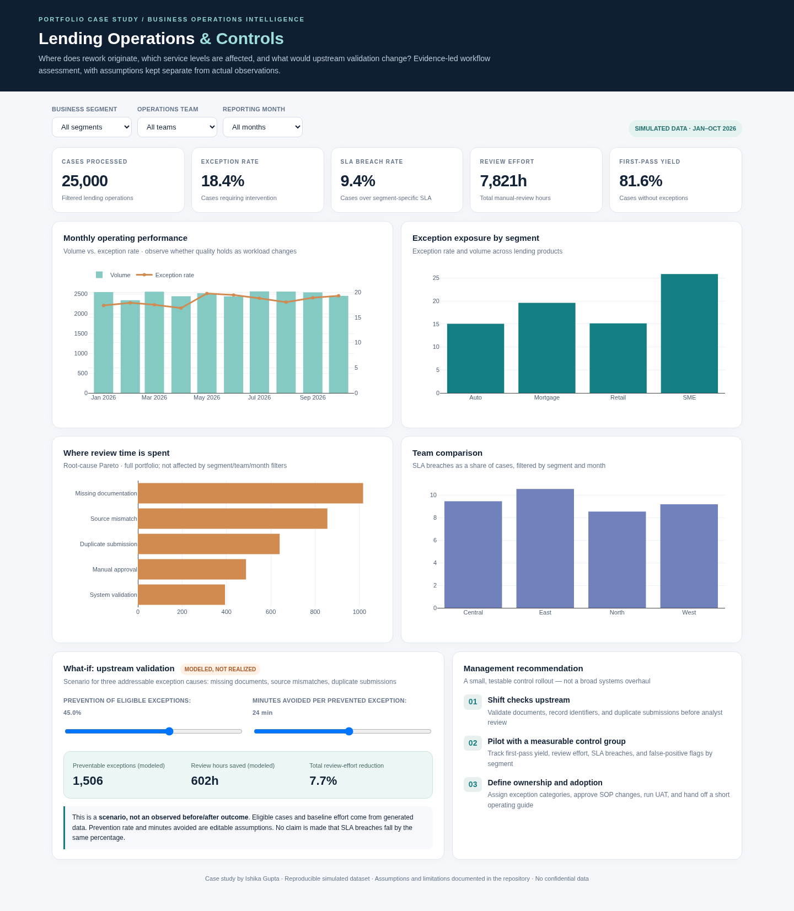

# Lending Operations & Controls | A Business Process Improvement Case Study

**A practical business-analysis project: 25,000 synthetic lending cases → root-cause investigation → control redesign → measurable what-if business case.**

This project starts with an operations question, not a dashboard: **what causes avoidable rework in lending workflows, and which preventive controls deserve a pilot?** It combines SQL, Python, performance reporting, business requirements, process mapping, UAT planning and an implementation recommendation.

> **Data integrity:** Everything is based on simulated banking-operations records created for this portfolio. No TD, employer or customer data is included. Baseline figures describe the generated dataset. Savings are *scenario estimates*, not achieved production outcomes.

## Open the dashboard

**[Launch interactive dashboard](dashboard/index.html)** — download the repository and open `dashboard/index.html` directly in a browser. It works without running Python or connecting to the internet.

The dashboard allows you to filter by **business segment, operations team and reporting month** and adjust scenario assumptions to see how potential review-hour savings change. It includes a live KPI overview, monthly operating-performance trend, segment exception comparison, root-cause view, team SLA comparison and an implementation recommendation.



## Executive snapshot

| Measured on simulated data | Result |
|---|---:|
| Case volume | **25,000** |
| Cases requiring manual exception handling | **4,592 (18.37%)** |
| First-pass yield | **81.63%** |
| SLA breach rate | **9.44%** |
| Baseline review effort | **7,820.9 hours** |
| Exceptions with addressable root causes | **3,347 (72.9% of exceptions)** |

**Where to focus:** SME cases show the highest exception rate in this dataset (25.86%), making them a reasonable segment to investigate for a pilot. The three selected addressable causes are missing documentation, source mismatches and duplicate submissions. They are plausible candidates for early validation; manual approvals are deliberately excluded from automatic prevention.

### Modeled opportunity — *not actual savings*

With an assumed **45% prevention** of eligible exceptions and **24 minutes** saved per prevented exception, the model estimates:

- **~1,506 exceptions prevented**
- **~602.5 analyst review hours avoided** across the 25,000 simulated cases
- **7.7% reduction in total review effort**, holding the assumptions constant

These are explicit assumptions with sliders on the dashboard. No actual cost savings, deployment results or SLA improvement are claimed. The executive brief explains the pilot design needed to validate the business case.

## How the work was approached

| Stage | Decision / work product | Evidence |
|---|---|---|
| Define | Translate repeated exceptions into a business problem and decision request | [Decision brief](docs/01_executive_brief.md) |
| Investigate | Validate baseline quality, segment exposure, root causes and SLA patterns | [SQL queries](sql/), [Python analysis](src/analyze.py) |
| Design | Map as-is vs. to-be intake and define control ownership | [Process maps](docs/03_process_maps.md) |
| Specify | Write requirements, stakeholders and measurable acceptance criteria | [Business requirements](docs/02_business_requirements.md) |
| Test | Create negative cases, audit and override tests, and pilot acceptance gates | [UAT and risk register](docs/04_uat_and_risk_register.md) |
| Communicate | Present trade-offs, assumptions, dashboard and pilot recommendation | [Dashboard](dashboard/index.html), [Decision brief](docs/01_executive_brief.md) |

## Reproduce the analysis

Requires Python 3.10+.

```bash
pip install -r requirements.txt
python src/run_pipeline.py
python -m unittest discover -s tests -v
```

The pipeline regenerates 25,000 cases using a fixed seed, recalculates metrics, checks SQL totals, and rebuilds the dashboard. You can also open the prebuilt HTML dashboard immediately, without installing anything. To publish it as a live site, enable **GitHub Pages → Deploy from a branch → main / (root)**; the root `index.html` redirects to the dashboard. Plotly's JavaScript is bundled directly in that file.

### Repository contents

```text
dashboard/
  index.html                 Interactive, standalone dashboard
  preview.png                Dashboard screenshot
src/
  generate_data.py           Synthetic case generation with reproducible seed
  analyze.py                 KPI definitions, SQL cross-check, scenario math
  build_dashboard.py         Offline HTML report builder
  run_pipeline.py            One-command reproducible build
sql/
  01_baseline_kpis.sql       Exception, SLA and review-effort KPIs
  02_root_cause_and_sla.sql  Root-cause / segment analysis
  03_monthly_quality.sql     Monthly trends by segment
docs/
  01_executive_brief.md      Decision, modeled benefit, caveats
  02_business_requirements.md
  03_process_maps.md        As-is/to-be Mermaid workflows and RACI
  future_state_workflow.bpmn  Proposed BPMN 2.0 process definition
  04_uat_and_risk_register.md
  05_data_dictionary.md
outputs/                     Calculated metrics and dashboard aggregates
data/                        Synthetic cases (CSV)
tests/                       Unit tests for data and business calculations
```

## Skills demonstrated

**Business analysis:** problem framing, requirements, risk and control assessment, BPMN-style workflow mapping, process redesign, stakeholder/RACI planning, UAT scenarios, proposed operating procedures, knowledge-transfer planning.

**Analytics and reporting:** SQL aggregation, Python data validation, exception root-cause analysis, KPI definition, segment and team comparisons, interactive Plotly reporting, sensitivity modeling, reproducible test cases.

**Management judgment:** prioritize preventive checks over expensive blanket automation; separate observed synthetic baseline from scenario assumptions; insist on a limited pilot and sign-off before wider rollout.

## Limitations and responsible interpretation

1. This is a **fictional operating environment**, not a retrospective study of a real bank.
2. Synthetic trends reflect the generator's assumptions; they do not estimate real-world exception rates.
3. Modeled savings represent review effort only and do not establish realized financial benefits.
4. The pilot plan, controls, SOP and UAT cases are **proposals**, not proof of production implementation.
5. An actual launch would require validated rules, stakeholder approval, security review, observed pilot outcomes and change management.

**Portfolio author:** Ishika Gupta · Business analysis, financial operations and process improvement.
