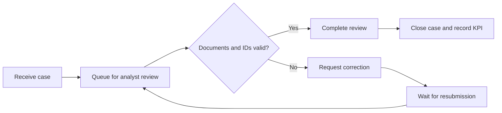
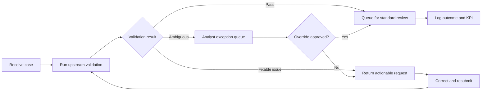

# As-is and to-be workflows

These are **proposed** operating models based on a synthetic case study, not observed internal bank processes.

## As-is: exception identified after intake

**Failure modes:** manual detection occurs late; repeat hand-offs; duplicated checking; inconsistent reasons for return.

## To-be: controls before manual queue

**Controls:** validation rule ownership, exception code, override reasons, timestamped decisions, audit trail and a fallback manual route.

## Implementation stages

1. Baseline measurement and root-cause validation with Operations and Credit.
2. Requirements sign-off, rule design, and data quality check with Technology.
3. UAT including negative scenarios and false-positive handling.
4. Limited pilot, weekly management reporting, and benefit validation.
5. Training and knowledge transfer to end users; SOP approval before scaled rollout.

## RACI (suggested)

| Activity | Operations | Credit risk | Technology | Finance |
|---|---|---|---|---|
| Define pain points | A/R | C | C | C |
| Approve controls | R | A | C | I |
| Implement validation | C | C | A/R | I |
| Conduct UAT | A/R | R | R | I |
| Validate benefit model | C | I | C | A/R |
| Rollout and knowledge transfer | A/R | C | R | I |

A = Accountable, R = Responsible, C = Consulted, I = Informed. These assignments are proposed, not confirmed organizational roles.
